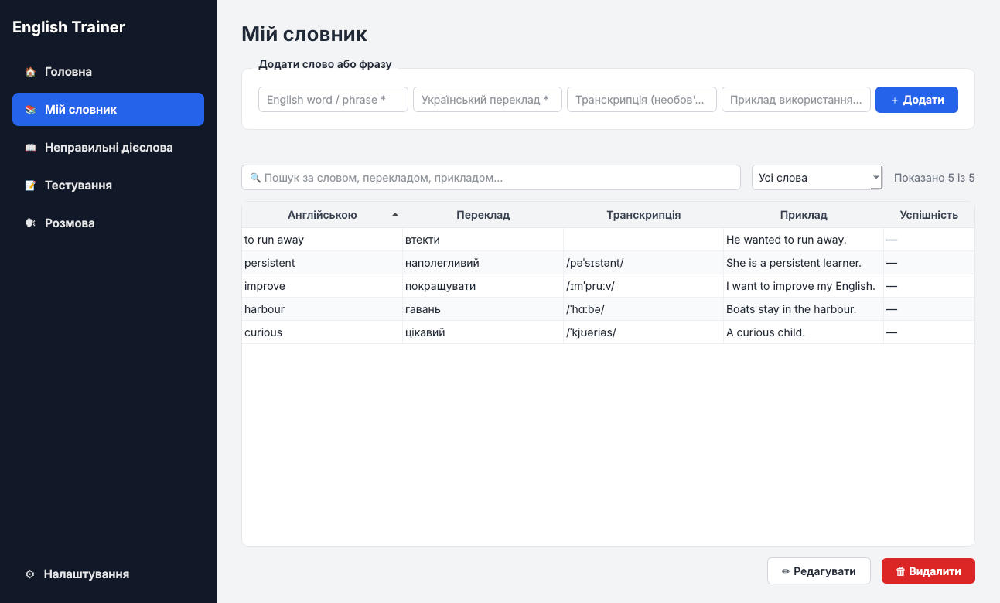
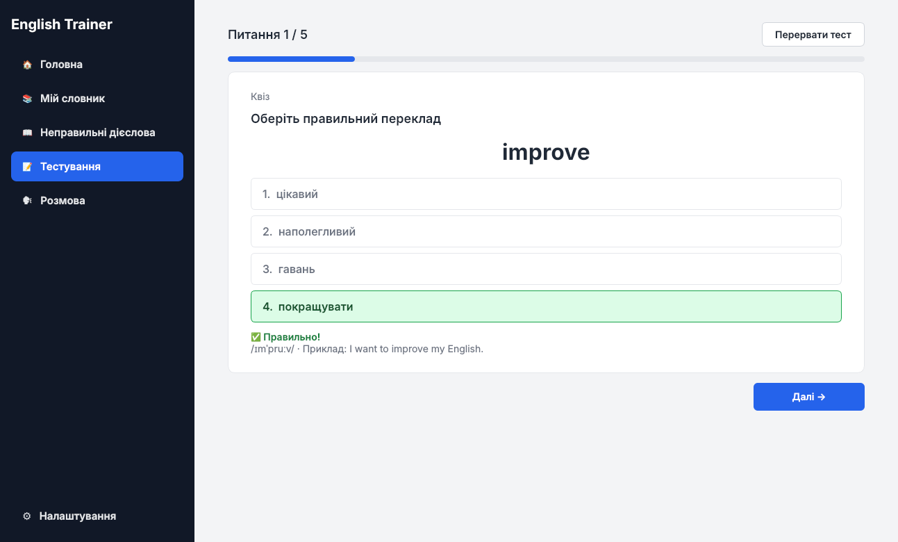
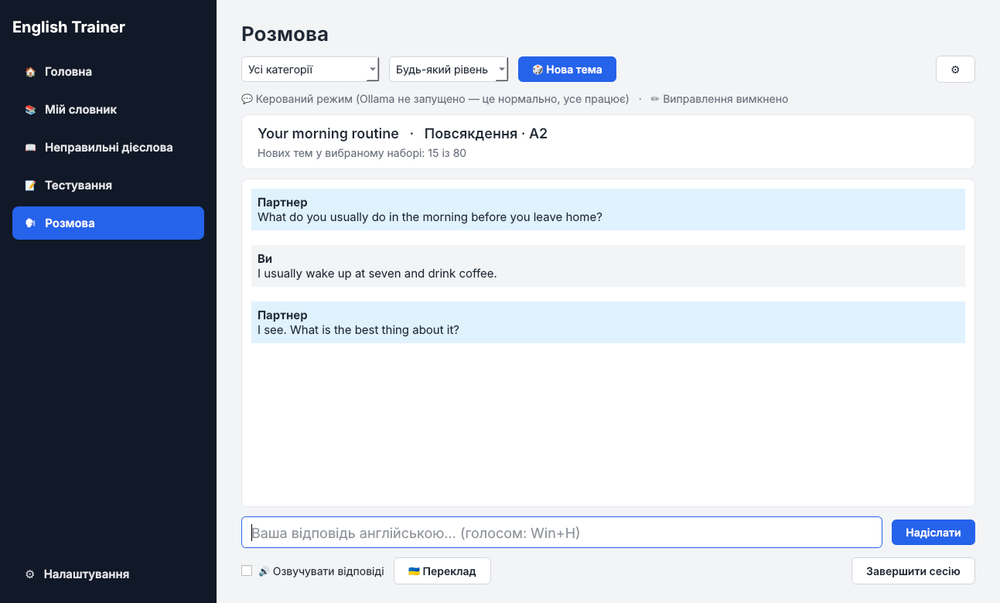

# English Trainer

Desktop app for learning English vocabulary and practising speaking.
Python 3.11+ · PySide6 · SQLite · optional local LLM (Ollama).

The interface is in Ukrainian; the learning content is English.

| Vocabulary | Test | Conversation |
|---|---|---|
|  |  |  |

## Features

- **My vocabulary** – add / edit / delete words with translation, transcription and example; search, filters, per-word accuracy.
- **Irregular verbs** – built-in table of 120 verbs (V1 / V2 / V3 + translation), search by any form, text-to-speech.
- **Flexible tests** – pick words with checkboxes, choose the number of questions. Nine question types:
  translation both ways, dictation and listening-translation, spot-the-mistake, 4-option quiz,
  and verb-specific modes (fill missing forms, translate, listening).
  Results screen with a detailed review of mistakes and "repeat mistakes only".
- **Conversation practice** – 80 topics (8 categories, A2–C1) that never repeat until the chosen set is exhausted;
  grammar feedback after every message; built-in translation of the partner's questions.
- **Statistics** – every answer is stored (`stats` + `answer_log`), the groundwork for spaced repetition.

## Quick start

```bash
python -m venv .venv
# Windows: .venv\Scripts\activate      Linux/macOS: source .venv/bin/activate
pip install -r requirements.txt
python main.py
```

Optional: `pip install gTTS` for online speech with better pronunciation (choose it in *Settings*).
On Linux, pyttsx3 needs `espeak-ng`. User data is stored in `data/english_trainer.db` (git-ignored).

## Conversation modes

| Mode | Needs | Notes |
|---|---|---|
| **Guided** (default) | nothing | Scripted follow-up questions per topic. Works on any machine, offline. It does not understand the content of your answers. |
| **Ollama** | [Ollama](https://ollama.com) + a small model, e.g. `ollama pull qwen2.5:1.5b` (~1 GB) | Real dialogue with a local model. Falls back to guided mode if the model stops responding. |

Grammar correction uses the public [LanguageTool](https://languagetool.org) API and translation uses
[MyMemory](https://mymemory.translated.net). Both are free, need internet and have rate limits.
**Text typed in the Conversation section is sent to these services.** The app asks for consent before the
first grammar check; it can be switched off or pointed to a self-hosted LanguageTool server in the settings (⚙).

**Built-in rate limiting** (`app/limits.py`): before every external call the app first checks its own limits and
only then lets the request go out; if a limit is hit, no request is sent and a clear message is shown.
Limits are set below the published ones: LanguageTool 12 requests/min, 50 000 chars/min, 1 s between requests;
MyMemory 10 requests/min and a persistent daily budget of 4 500 characters (stored in SQLite, survives restarts);
gTTS 20 requests/min (cached audio is free). If a server still answers HTTP 429, the app pauses that service
(LanguageTool: 60 s, MyMemory: until the next UTC day). Pointing LanguageTool to your own server removes its limits.

Voice input: use the OS dictation (Windows: `Win+H`, with the **English** keyboard layout active).

## Architecture

```
main.py                 entry point
app/
  database.py           SQLite access: words, verbs, stats, topic history, settings
  quiz.py               question generation + answer checking (no GUI dependencies)
  topics_data.py        conversation topics + no-repeat topic picker
  limits.py             pre-request rate limiter + persistent daily budget (stdlib only)
  ai.py                 Ollama / LanguageTool / MyMemory clients, conversation partner (stdlib only)
  tts.py                pyttsx3 or gTTS + QMediaPlayer, runs in a worker thread
  verbs_data.py         built-in irregular verbs
  ui/                   PySide6 pages (network calls run in QThread workers)
tests/                  pytest suite (logic is tested without Qt; GUI smoke test runs headless)
```

## Tests

```bash
pip install -r requirements-dev.txt
pytest                    # everything
pytest -m "not gui"       # without PySide6
```

## License

MIT – see [LICENSE](LICENSE). Third-party packages and external services are listed in [NOTICE](NOTICE).
